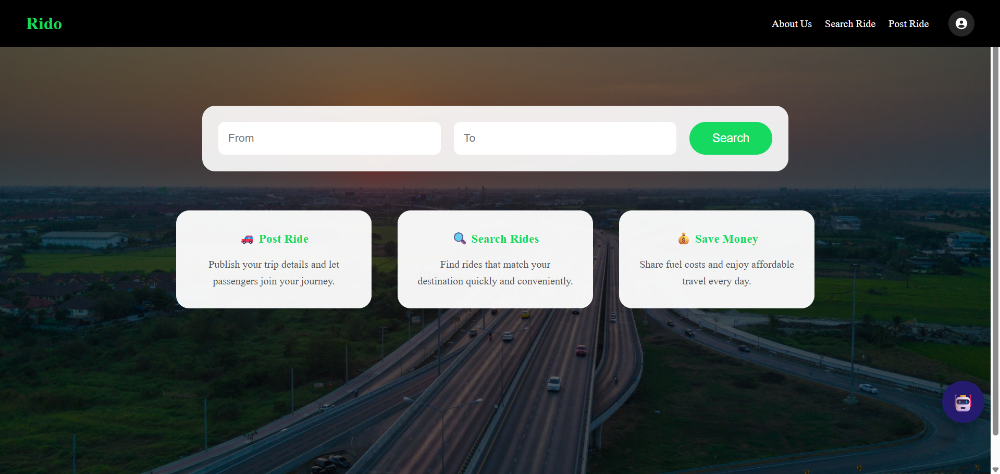
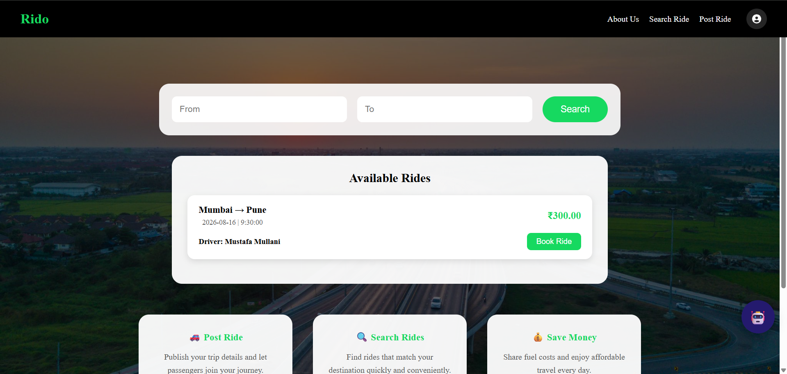
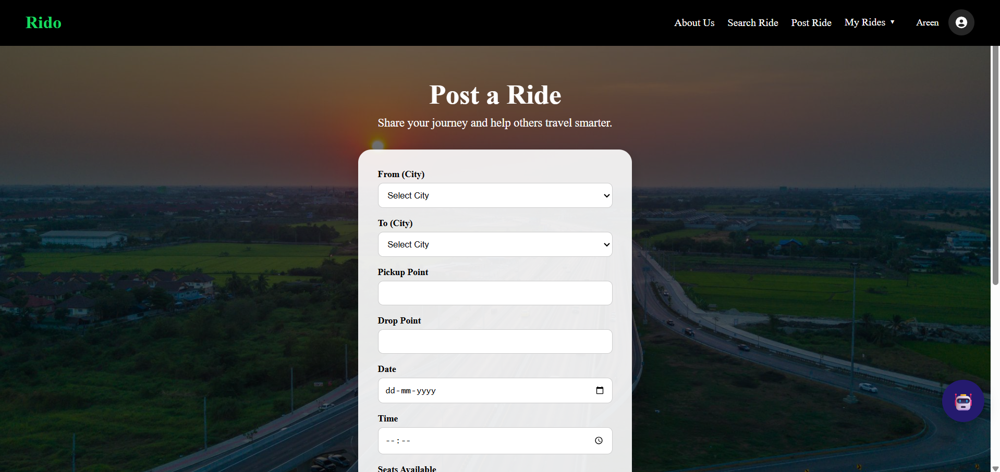
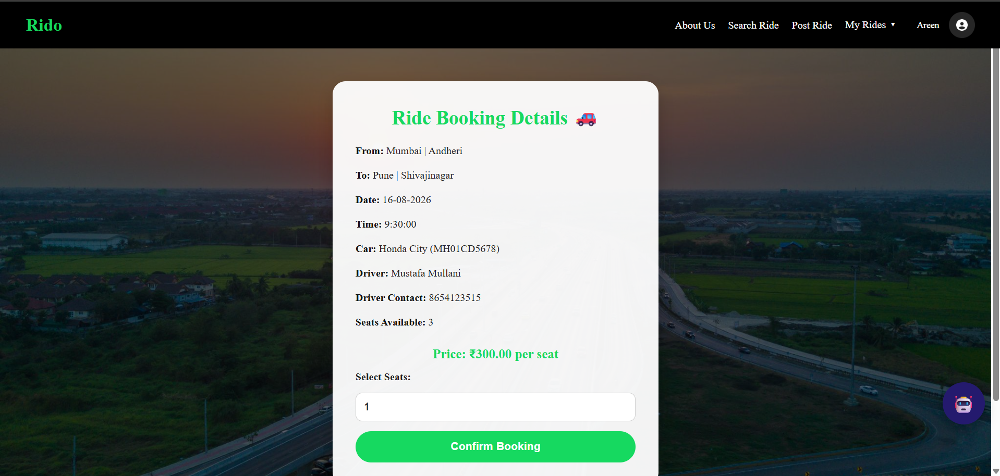
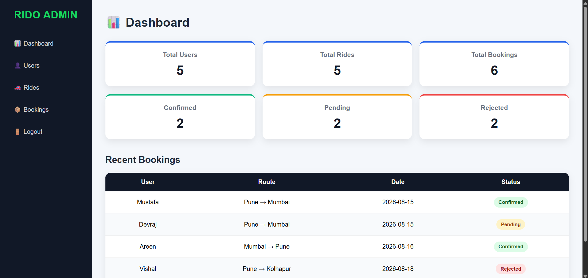
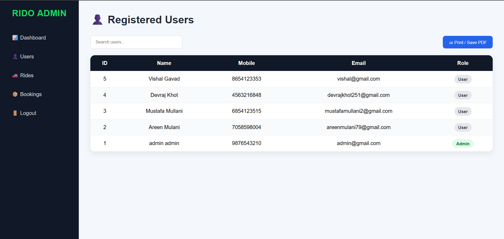
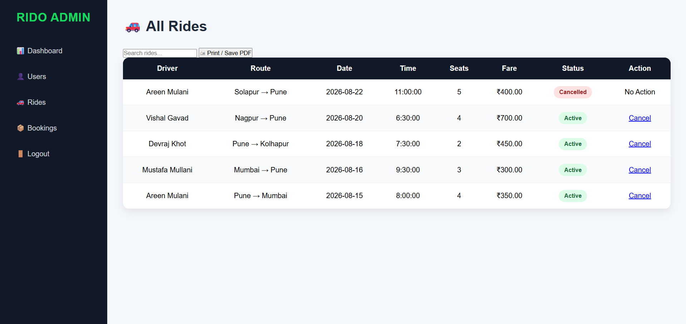
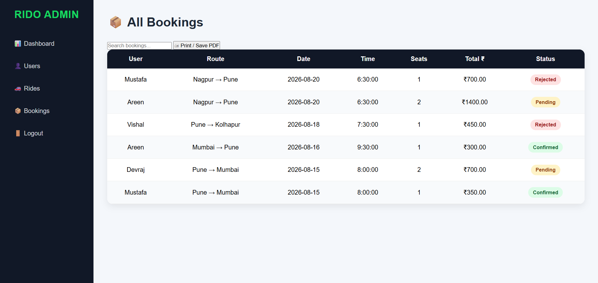

# 🚗 Rido: Carpooling Web Application

Rido is a full-stack carpooling web application that connects drivers who have empty seats with passengers travelling the same way. Drivers post rides, passengers search and book seats, and drivers approve or reject each request. An admin dashboard lets administrators manage users, rides and bookings.

🔗 **Live demo:** https://rido-carpooling-web-application.onrender.com
💻 **Source code:** https://github.com/Areen1011/Rido-Carpooling-Web-Application

> **Note:** The demo runs on free hosting tiers, so the **first load may take up to a minute** while the server wakes up.
> **Demo only:** please use dummy data (fake name and mobile number) when registering. Do not enter real personal details.

---

## ✨ Features

**For users**
- Register and log in (age 18+ check, hashed passwords)
- Post a ride with route, pickup/drop points, date, time, seats, car details and fare
- Search rides by from/to location (past and full rides are hidden)
- Book seats and track status: pending, confirmed or rejected
- Email notification when a booking request is submitted
- Drivers can confirm or reject requests, and cancel their rides
- Passengers can cancel their bookings
- Profile page and a built-in help chatbot

**For admins**
- Dashboard with totals for users, rides and bookings, plus recent activity
- Search and view users (with their posted and booked rides), delete users
- View and cancel rides
- View all bookings

---

## 📸 Screenshots

| Home Page | Search Rides |
|---|---|
|  |  |

| Post a Ride | Ride Booking |
|---|---|
|  |  |

| Admin Dashboard | Admin: Users |
|---|---|
|  |  |

| Admin: Rides | Admin: Bookings |
|---|---|
|  |  |

---

## 🛠 Tech Stack

- **Backend:** Python, Flask
- **Database:** MySQL (connection pooling with `mysql-connector-python`)
- **Frontend:** HTML, CSS, JavaScript (Jinja2 templates)
- **Email:** Brevo transactional email API
- **Hosting:** Render (web app), Aiven (managed MySQL)

---

## 🗄 Database Schema

Three tables: `users`, `rides` and `bookings`.
- `rides.driver_id` references `users.id`
- `bookings.ride_id` references `rides.id` and `bookings.user_id` references `users.id`

The full schema is in `database.sql`.

---

## 🚀 Run Locally

1. **Clone the repo**
   ```bash
   git clone https://github.com/Areen1011/Rido-Carpooling-Web-Application.git
   cd Rido-Carpooling-Web-Application
   ```

2. **Create a virtual environment and install dependencies**
   ```bash
   python -m venv venv
   venv\Scripts\activate        # Windows
   # source venv/bin/activate   # macOS / Linux
   pip install -r requirements.txt
   ```

3. **Create the database** by running `database.sql` in MySQL (it creates the `carpool` database and the three tables).

4. **Create a `.env` file** in the project root (never commit this file):
   ```env
   SECRET_KEY=your_secret_key
   DB_HOST=localhost
   DB_PORT=3306
   DB_USER=root
   DB_PASSWORD=your_mysql_password
   DB_NAME=carpool
   EMAIL_ADDRESS=your_verified_sender_email
   BREVO_API_KEY=your_brevo_api_key
   ```

5. **Run the app**
   ```bash
   python app.py
   ```
   Open http://127.0.0.1:5000

### Make an admin
Register a normal account, then run in MySQL:
```sql
UPDATE users SET role='admin' WHERE email='your-admin@email.com';
```
Log out and log in again to open the admin dashboard.

---

## ☁️ Deployment

- **Database:** managed MySQL on Aiven (create the tables with `database.sql`, minus the `CREATE DATABASE` and `USE` lines)
- **Web app:** Render web service
  - Build command: `pip install -r requirements.txt`
  - Start command: `gunicorn app:app`
  - Environment variables: `SECRET_KEY`, `DB_HOST`, `DB_PORT`, `DB_USER`, `DB_PASSWORD`, `DB_NAME`, `EMAIL_ADDRESS`, `BREVO_API_KEY`
- **Email:** sent through Brevo's HTTPS API, because Render's free tier blocks outbound SMTP ports

---

## 👩‍💻 Author

**Areen Mulani**
[GitHub](https://github.com/Areen1011)

*Built as a graduation project.*
